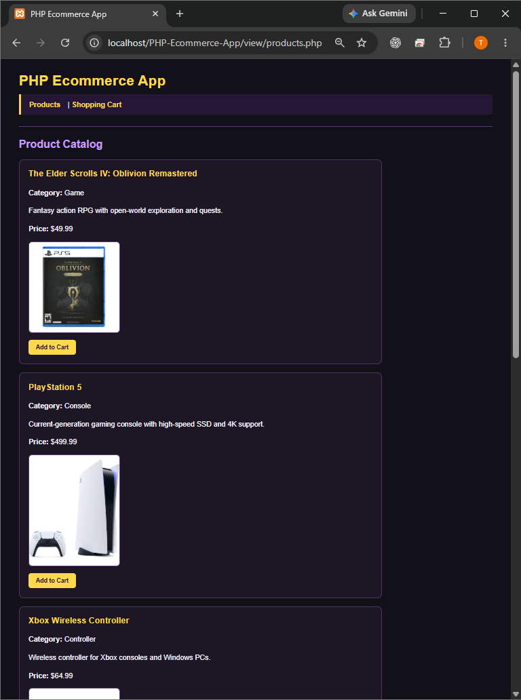
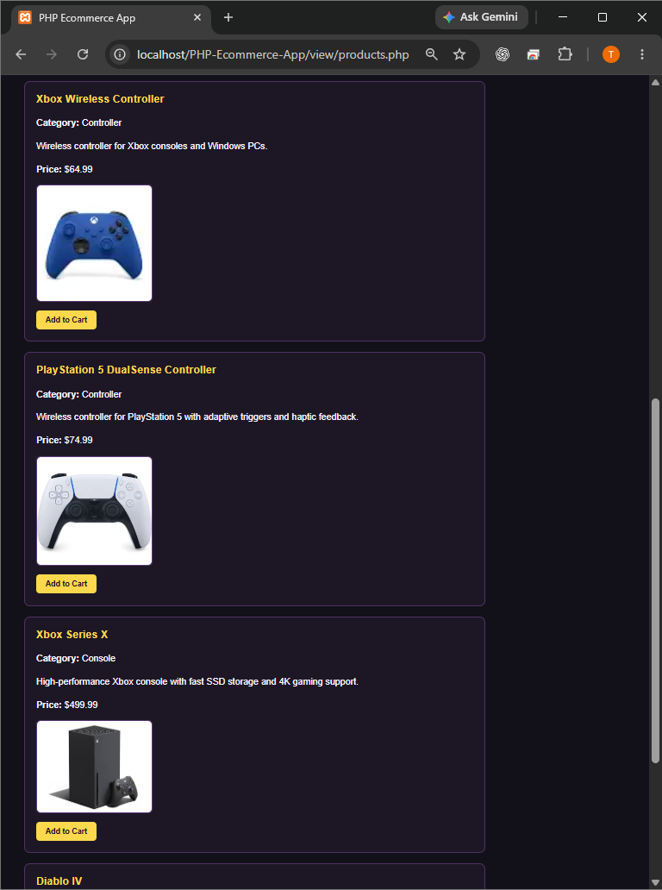
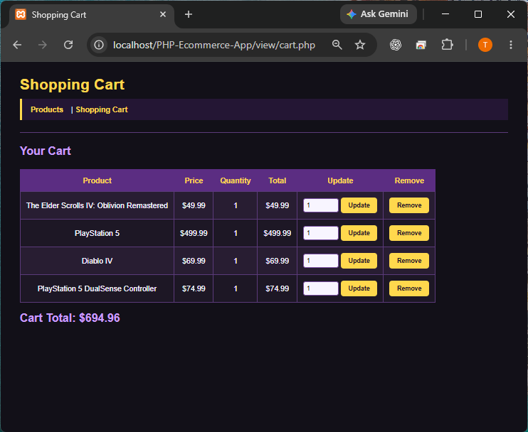

# Project Summary

## Project Name
PHP Ecommerce App

## Project Description
The PHP Ecommerce App is a database-backed video game storefront developed throughout the Server-Side Scripting with PHP Lab course. The application displays products from a MySQL/MariaDB database and allows users to add products to a shopping cart, update quantities, and remove items. The project was later reorganized using the Model-View-Controller (MVC) architecture and given a custom gaming-themed interface.

## Project Tasks
- Created the initial PHP ecommerce application structure
- Designed and populated the product and cart database tables
- Connected PHP pages to the database
- Displayed product information dynamically from the database
- Implemented Add to Cart functionality
- Implemented cart quantity updates and item removal
- Refactored the application into Model, View, and Controller components
- Added product images
- Added shared CSS styling for the product catalog and shopping cart
- Tested product display, navigation, cart operations, database access, and application behavior
- Used Git and GitHub to track development progress and create project releases

## Skills Demonstrated
- PHP server-side scripting
- MySQL/MariaDB database integration
- SQL queries and database-backed applications
- CRUD-related application functionality
- Model-View-Controller architecture
- HTML and CSS interface development
- Debugging and application testing
- Git and GitHub version control
- Incremental software development

## Technologies Used
- PHP
- MySQL/MariaDB
- HTML
- CSS
- Apache
- XAMPP
- Visual Studio Code
- Git and GitHub

## Development Process
The application was developed incrementally throughout the course. Each week added or improved a major part of the project, including database support, shopping cart functionality, MVC organization, interface improvements, and final testing. GitHub commits and release tags were used to document major project phases.

## Repository
https://github.com/TORLAW1692/PHP-Ecommerce-App

## Application Screenshots

These screenshots show the PHP E-commerce App running locally with Apache and MySQL/MariaDB through XAMPP. They document the product catalog and database-backed shopping cart. The `localhost` address shown in the browser is a local development environment, not a publicly hosted demo.

### Product Catalog — First Products

### Product Catalog — Additional Products

### Shopping Cart

